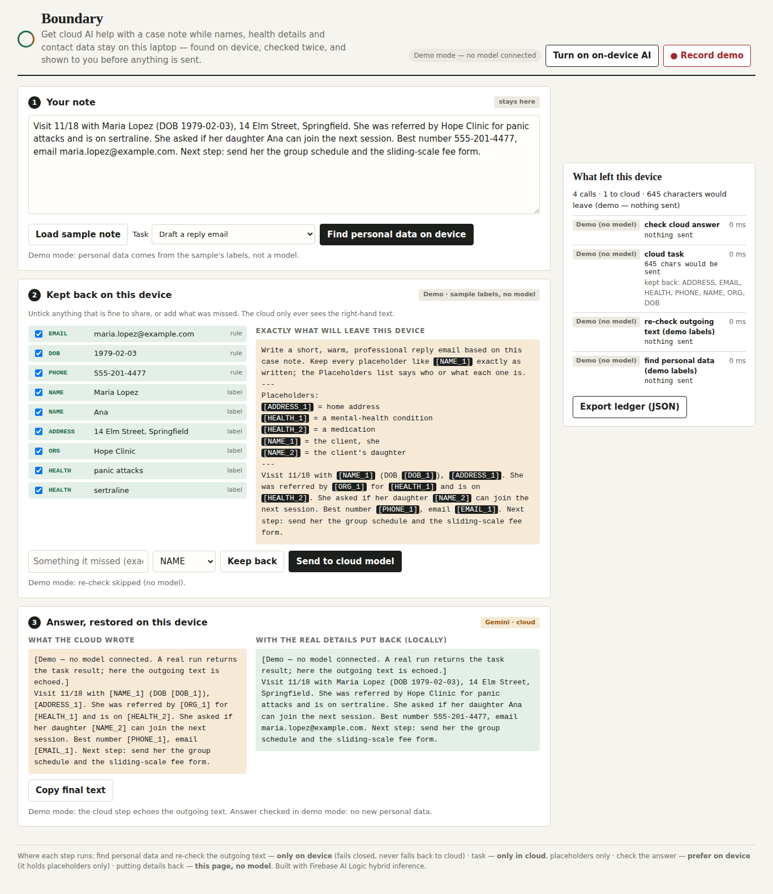

# Boundary

**Cloud AI help with a case note, while names, health details and contact data stay on this laptop.** Boundary reduces what leaves the device and shows you exactly what does — it does not certify a note as anonymous.

Caseworkers, counsellors and small-clinic coordinators write notes full of personal data. Cloud models are great at turning those notes into a reply email, a handover summary or a translation — but pasting the note into a chatbot sends a client's name, diagnosis and address to a server. Boundary splits the job along that line with **Firebase AI Logic hybrid inference**:

| Step | Runs where | Firebase AI Logic mode | If it fails |
|---|---|---|---|
| 1. Find personal data | Gemini Nano in Chrome + deterministic rules | `InferenceMode.ONLY_ON_DEVICE` | **Stops.** Nothing is sent — it never falls back to the cloud with raw text |
| 2. Review what leaves | This page | — | Send locks while the rules still see a phone, e-mail, ID or date of birth; unticking a name, health detail, address or ID asks for confirmation |
| 3. Re-check the outgoing text | Gemini Nano | `InferenceMode.ONLY_ON_DEVICE` | Anything Nano still calls personal is kept back and Send stops for review; if Nano fails, nothing is sent |
| 4. Do the task (reply / handover / translate) | Gemini in the cloud | `InferenceMode.ONLY_IN_CLOUD` | Receives placeholder text only, e.g. `[NAME_1]`, `[HEALTH_2]` |
| 5. Check the answer | Nano, cloud fallback | `InferenceMode.PREFER_ON_DEVICE` | The answer holds placeholders only, so a fallback is safe; flags personal-looking data the cloud invented |
| 6. Put the real details back | This page, no model | — | Warns if the answer dropped a placeholder |

Every model call is written to a **"What left this device" ledger**: where it ran (from the SDK's `inferenceSource`; an on-device step whose source is not reported as on-device is treated as a failure), how many characters were sent, and which kinds of data were kept back. The ledger can be exported as JSON. The placeholder map lives in memory only — it is never in the ledger or in any prompt.

## Why hybrid, and why this split
- The private steps must be on device, so they use `ONLY_ON_DEVICE` and **fail closed**: if Nano is unavailable, returns unusable JSON, is the echo stub that plain Chromium ships, or the SDK does not report the answer as on-device, Boundary refuses to continue (`src/deviceSpans.js`). Nano answers under a JSON schema (`responseConstraint`), and spans must match the note word for word.
- The heavy step (writing a good email in another language) is where a large cloud model is worth it — by then the text has been checked twice on device and reviewed by you.
- Placeholders carry short **role hints** written on device ("`[NAME_1]` = the client, she", "`[HEALTH_2]` = a medication") so the cloud can write a natural reply. A hint is dropped if it repeats any word of a kept-back value, contains digits, or matches a personal-data rule — e.g. "the referring clinic" is dropped for "Hope Clinic". Hints appear in the outgoing preview like everything else.
- Checking the answer is the one step where `PREFER_ON_DEVICE` is right: the text holds placeholders only, so a cloud fallback leaks nothing.
- You see the exact outgoing text before anything is sent, can untick details that are fine to share, and can add anything the model missed.

## How reliable is the on-device check?
We measure it instead of assuming it (`eval/`): 10 synthetic notes with 44 labelled personal-data spans (invented people, `example.*` domains, test numbers).
- Rules layer alone: recall **0.295** — catches e-mails, phone numbers, IDs, dates of birth; misses every name, address, organisation and health detail. That is why the rules layer alone is never allowed to clear a note for the cloud.
- Gemini Nano layer: open `eval.html` in Chrome with Nano → **Run on-device eval** → recall is shown on the page for rules only / rules + Nano / + Nano re-check, per class, plus role-hint leaks (also downloadable as `device_spans.json` for `node eval/score.js`). _Result: to be filled from the recorded run._



## Try it
Live: https://taewoo-won.github.io/boundary-hybrid-ai/ (Google Chrome desktop with Gemini Nano; the on-device model downloads on first use) · Boundary eval: https://taewoo-won.github.io/boundary-hybrid-ai/eval.html

## Run it
```bash
npm install
npm test          # boundary + pipeline tests (node --test)
npm run dev       # http://localhost:5173
```
Without a Firebase config the app runs in **demo mode**: the whole UI, ledger and recorder work, step 1 uses the sample notes' hand labels (shown as "label"), and the cloud step echoes the outgoing text. The header says "Demo mode" so this is never confused with a real run.

With Firebase (Chrome desktop 139+ with Gemini Nano available):
1. Create a Firebase project, enable **Firebase AI Logic** (Gemini Developer API) and register the web app in **App Check** — Firebase enforces App Check for AI Logic in every project, so cloud calls without a token are refused. This repo uses a score-based **reCAPTCHA Enterprise** key restricted to the page's domain (`src/appcheck.public.json`); debug tokens are fine for local testing.
2. Put the public web config in `.env.local`:
   ```
   VITE_FIREBASE_CONFIG={"apiKey":"…","authDomain":"…","projectId":"…","appId":"…"}
   VITE_RECAPTCHA_ENTERPRISE_SITE_KEY=…   # or VITE_RECAPTCHA_SITE_KEY for a reCAPTCHA v3 key
   ```
3. `npm run dev`, click **Turn on on-device AI** (the model download must start from a user click), then load a sample note.

Firebase AI Logic is imported and called at runtime in `src/hybrid.js` (`getAI`, `getGenerativeModel` with `InferenceMode`, `initializeDeviceModel`, `generateContent`, `inferenceSource`).

## Record the demo in the app
**● Record demo** captures this tab with `getDisplayMedia` + `MediaRecorder` and downloads a `.webm` — no screen-recording software needed. It warns after 2:50 (the video limit is 3:00).

## Files
`src/pipeline.js` boundary pipeline · `src/redact.js` rules + reversible placeholders · `src/deviceSpans.js` Nano pass (fail closed) · `src/hybrid.js` Firebase AI Logic models per mode · `src/ledger.js`, `src/ledgerView.js` ledger · `src/recorder.js` in-app recorder · `eval/` reliability measurement · `test/` tests.

## Limits
- Detection is best effort: the review screen exists because no detector is perfect. Boundary reduces what leaves the device; it does not certify a note as anonymous.
- On-device inference needs desktop Chrome with Gemini Nano; elsewhere step 1 fails closed and nothing is sent.

## License
Apache-2.0 — see `LICENSE`.
